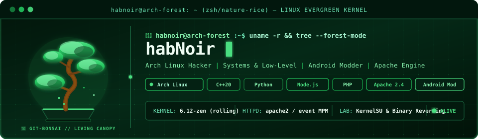
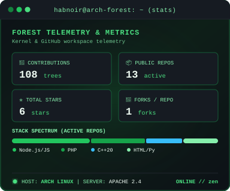

<div align="center">

<!-- Deep Nature Forest & Arch Linux Banner -->


<br/>

```text
 ---------------------------------------------------------------------------------------
  [ECO_SYS] :: ARCH LINUX EVERGREEN KERNEL // NATURE FOREST LAB // APACHE 2.4 // ANDROID
 ---------------------------------------------------------------------------------------
```

</div>

---

### `[0x01]` // ARCH LINUX SYSTEM BIOME & ENVIRONMENT

```ansi
 [32m       /\ [0m              [1;32mhabNoir [0m@ [1;32march-forest [0m
 [32m      /  \ [0m            -------------------
 [32m     /\   \ [0m            [1;32mOS [0m: Arch Linux x86_64 [evergreen rolling]
 [32m    /      \ [0m           [1;32mKernel [0m: 6.12.x-zen-nature / hardened
 [32m   /   ,,   \ [0m          [1;32mShell [0m: zsh 5.9 (powerlevel10k forest)
 [32m  /   |  |  -\ [0m         [1;32mWeb Server Engine [0m: Apache/2.4 (event MPM + HTTP/2)
 [32m /_-''    ''-_\ [0m        [1;32mPrimary Stack [0m: C++20 | Python 3.12 | Node.js (LTS) | PHP 8.3
                        [1;32mSpecialization [0m: Android Modding (KernelSU/Magisk) & Reverse Eng
                        [1;32mBiome Status [0m: Planting trees via commits, compiling from source
```

---

### `[0x02]` // THE LIVING GROVE: COMMIT BONSAI & NATURE STATS

> *A procedural pixel-art bonsai that photosynthesizes through GitHub contributions, paired with 100% bespoke real-time forest telemetry.*

<div align="center">
<table border="0" width="100%">
  <tr>
    <td width="50%" align="center" valign="top">
      
    </td>
    <td width="50%" align="center" valign="top">
      
    </td>
  </tr>
</table>

<br/>

<!-- Real-time Nature Streak Matrix -->


</div>

---

### `[0x03]` // FOREST CONTRIBUTION TREE GRAPH

> *Setiap kotak kontribusi digantikan oleh pohon piksel hidup di atas kanvas tanah hutan Arch Linux. Semakin banyak commit dalam sehari, semakin rimbun dan tinggi pohon yang tumbuh (Dormant → Sapling → Thriving Pine → Ancient Oak).*

<div align="center">

<!-- Pure Custom Generated Forest Tree Graph (Updated by GitHub Actions) -->


<br/>

<!-- Optional 3D Isometric Green Terrain (Generated via .github/workflows/profile-3d.yml) -->
<details>
<summary><b>📐 View 3D Isometric Green City/Terrain Blocks (Click to expand)</b></summary>
<br/>
<p align="center">
  
</p>
</details>

</div>

---

### `[0x04]` // AUTO-GENERATED ACTIVE REPOSITORIES

<p align="left">
  <i>Auto-synchronized by GitHub Actions workflow on every push / scheduled daily.</i>
</p>

<!-- REPOS-LIST:START -->
| 📦 Project / Repository | 📝 Focus / Description | ⚡ Primary Tech | ⭐ Stars | 🕒 Last Push |
| :--- | :--- | :---: | :---: | :---: |
| **[`habNoir / vibe-motion-lyrics`](https://github.com/habNoir/vibe-motion-lyrics)** | 16:9 VS Code kinetic typography lyrics video studio with auto-sync AI backend (React JS + Vite) | `HTML` | `—` | `25m ago` |
| **[`habNoir / marimo`](https://github.com/habNoir/marimo)** | *No description provided* | 🟨 JavaScript | `★ 2` | `1mo ago` |
| **[`habNoir / NotAFK-HAB`](https://github.com/habNoir/NotAFK-HAB)** | *No description provided* | 🔵 C++ | `—` | `5mo ago` |
| **[`habNoir / habNoir.github.io`](https://github.com/habNoir/habNoir.github.io)** | *No description provided* | `HTML` | `—` | `9mo ago` |
| **[`habNoir / KeyBotz`](https://github.com/habNoir/KeyBotz)** | Lightweight WhatsApp bot built with Node.js, crafted by H4B of Key . | 🟨 JavaScript | `★ 2` | `13mo ago` |
| **[`habNoir / conditionalSteatments-PHP`](https://github.com/habNoir/conditionalSteatments-PHP)** | Tugas Ibu Ratna (Conditional Steatments) | 🐘 PHP | `—` | `13mo ago` |

<!-- REPOS-LIST:END -->

---

### `[0x05]` // ENGINEERING ARSENAL & TOOLING

```
┌── [CORE LANGUAGES]
│   ├── C++20          ── Modern low-level systems, memory management, native binaries
│   ├── Python 3.12    ── Automation scripts, reverse engineering tooling, APIs
│   ├── Node.js / TS   ── Fast event-driven servers, tooling, bots, async services
│   └── PHP 8.3        ── Robust backend architectures, server-side scripting
│
├── [SERVERS & ECOSYSTEM]
│   ├── Apache HTTPD   ── Event MPM, virtual hosts, reverse proxies, HTTP/2
│   ├── Arch Linux     ── Evergreen rolling distro, systemd, PKGBUILD, pacman
│   └── Linux Kernel   ── Kernel modules, compilation, sysfs/procfs tuning
│
└── [MOBILE & REVERSING LAB]
    ├── Android Modding── Magisk modules, KernelSU, Zygisk, custom ROM compilation
    ├── Binary Tooling ── Ghidra, Frida, Radare2, GDB, ADB / Fastboot
    └── Decompilation  ── Smali, JADX, Bytecode analysis, payload inspection
```

<div align="center">

| Domain | Weapon of Choice | Target Area |
| :--- | :--- | :--- |
| **Operating System** | `Arch Linux (btw)` | Native host, rolling optimization |
| **Web Server Engine**| `Apache 2.4 (event)` | High-throughput low-latency proxying |
| **Low-Level Dev**    | `C++20 / GCC / Clang` | Native daemons, hooking & systems |
| **Automation**       | `Python / Node.js` | Scripting, REST APIs, microservices |
| **Android Deep-Dive**| `KernelSU / AOSP` | Kernel patches, root hooks, binary mods |

</div>

---

### `[0x06]` // CONTACT & TERMINAL SESSION

<div align="center">

```bash
$ curl -s https://api.github.com/users/habNoir | jq '{login, bio, public_repos}'
```

[](mailto:wahabbh4b@gmail.com)
[](https://t.me/habNoir)
[](https://wa.me/628138174768)
[](https://github.com/habNoir)

<br/>

<sub><code>&gt; habNoir@arch-forest :: [STATUS: PHOTOSYNTHESIS_ACTIVE] :: 2026 :: Biome nominal.</code></sub>

</div>
