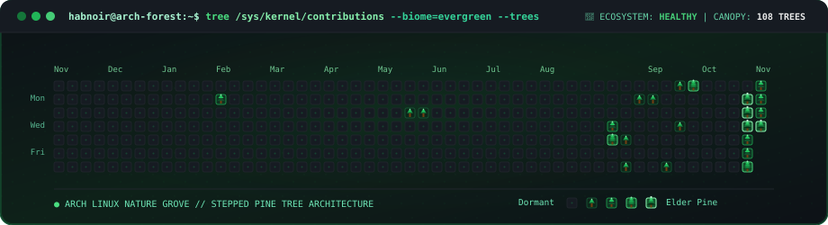

<div align="center">


</div>

---

### System Specs

```text
       /\                  habNoir@archbox
      /  \                -------------------
     /\   \               OS: Arch Linux x86_64
    /      \              Kernel: 6.12.x-zen / hardened
   /   ,,   \             Shell: zsh 5.9
  /   |  |  -\            Web Server Engine: Apache/2.4 (event MPM + HTTP/2)
 /_-''    ''-_\           Stack: C++20 | Python 3.12 | Node.js | PHP 8.3
                          Specialization: Android Modding (KernelSU/Magisk) & Reverse Engineering
                          Status: Active development
```

---

### Activity & Telemetry

<div align="center">
<table border="0" width="100%">
  <tr>
    <td width="50%" align="center" valign="top">
      
    </td>
    <td width="50%" align="center" valign="top">
      
    </td>
  </tr>
</table>

<br/>


</div>

---

### Contribution Landscape

<div align="center">



<br/><br/>



</div>

---

### Active Repositories

<!-- REPOS-LIST:START -->
| 📦 Project / Repository | 📝 Focus / Description | ⚡ Primary Tech | ⭐ Stars | 🕒 Last Push |
| :--- | :--- | :---: | :---: | :---: |
| **[`habNoir / pbrp_tecno_cn7c`](https://github.com/habNoir/pbrp_tecno_cn7c)** | PitchBlack Recovery Project (PBRP) Unofficial Device Tree & Surgical vendor_boot v4 Builder for TECNO CAMON 50 Pro 5G / Ultra 5G (TECNO-CN7c / Dimensity 7400 Ultimate MT6878V_E/TZA) \| Maintainer: habNoir | 🐍 Python | `—` | `59m ago` |
| **[`habNoir / device_tree_cn7c`](https://github.com/habNoir/device_tree_cn7c)** | Full Android 16 Device Tree for TECNO CAMON 50 Pro 5G & Ultra 5G (TECNO-CN7c / mt6878 \| Firmware: CN7c-16.3.0.160SP03(OP005PF001M1) \| All Variants 8/256GB, 12/256GB, 12/512GB) \| Maintainer: habNoir | `Makefile` | `—` | `6h ago` |
| **[`habNoir / habNoir-Clean`](https://github.com/habNoir/habNoir-Clean)** | Pembersih cache bertahap & folder sampah 3 lapis Android 12-17 (100% offline, 0 internet permission, ~2.56 MB, GPL-3.0-or-later) | 🟣 Kotlin | `★ 1` | `4d ago` |
| **[`habNoir / Porto`](https://github.com/habNoir/Porto)** | Bespoke Portfolio of habNoir (Alwahab Dzulikroom Butudoka) — Next.js 16, React 19, TypeScript, Tailwind CSS v4 | 🔷 TypeScript | `—` | `5d ago` |
| **[`habNoir / vibe-motion-lyrics`](https://github.com/habNoir/vibe-motion-lyrics)** | 16:9 VS Code kinetic typography lyrics video studio with auto-sync AI backend (React JS + Vite) | `HTML` | `—` | `8d ago` |
| **[`habNoir / marimo`](https://github.com/habNoir/marimo)** | *No description provided* | 🟨 JavaScript | `★ 2` | `1mo ago` |

<!-- REPOS-LIST:END -->

---

### Tooling & Stack

```
┌── [CORE LANGUAGES]
│   ├── C++20          ── Modern low-level systems, memory management, native binaries
│   ├── Python 3.12    ── Automation scripts, reverse engineering tooling, APIs
│   ├── Node.js / TS   ── Fast event-driven servers, tooling, bots, async services
│   └── PHP 8.3        ── Robust backend architectures, server-side scripting
│
├── [SERVERS & ECOSYSTEM]
│   ├── Apache HTTPD   ── Event MPM, virtual hosts, reverse proxies, HTTP/2
│   ├── Arch Linux     ── Main driver rolling distro, systemd, PKGBUILD, pacman
│   └── Linux Kernel   ── Kernel modules, compilation, sysfs/procfs tuning
│
└── [MOBILE & REVERSING LAB]
    ├── Android Modding── Magisk modules, KernelSU, Zygisk, custom ROM compilation
    ├── Binary Tooling ── Ghidra, Frida, Radare2, GDB, ADB / Fastboot
    └── Decompilation  ── Smali, JADX, Bytecode analysis, payload inspection
```

---

### Contact

<div align="center">

[](mailto:wahabbh4b@gmail.com)
[](https://t.me/habNoir)
[](https://wa.me/628138174768)
[](https://github.com/habNoir)

</div>
